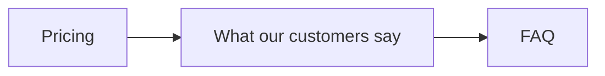

# Testimonial section on the home page

`164` · Feature · Medium size · **Low risk** — display only, nothing saved, hidden until switched on
**Status:** Draft · 2026-10-15 · **Approved by:** — · **Skill:** kodion-create-spec v2.6.0
**Task:** `.claude/tasks/164/task.json` · **Branch:** `feature/164-testimonial-section` (created by /start-task) · **Depends on:** real quotes before going live (Q1) · **Follows:** none
**Based on:** task description · live home page · no screenshots

> **Reviewer:** read the box. If every row looks right, reply **approve** — anyone can approve, at
> any risk. If a row looks wrong, the tables below and Part B have the detail. Part C is for plan mode.

---

# Part A — Review this

```
┌─ AT A GLANCE ─────────────────────────────────────────────────────┐
│ Goal     Visitors see real customer quotes below Pricing          │
│ Changes  Home page: new quote section between Pricing and FAQ     │
│ Won't    Photos, logos, star ratings, swipe, dark mode, menu link │
│ Keep     Pricing, FAQ, header, footer, button, booking demo       │
│ Danger   A fake quote, or one used without permission, goes live  │
│ Size     9 requirements · 19 checks · 4 places · Low risk         │
│ Needs    Q1 real quotes + permission (client), before going live  │
│ Verdict  Ready to approve · check D1, D3, D6                      │
└───────────────────────────────────────────────────────────────────┘
```



```
┌─────────┐  ┌────────────────────────┐  ┌─────┐
│         │  │                        │  │     │
│ Pricing ├─►│ What our customers say ├─►│ FAQ │
│         │  │                        │  │     │
└─────────┘  └────────────────────────┘  └─────┘
```

One quote at a time, changes every 6 seconds · pause, back, next, or jump to any quote · stays hidden until we switch it on.

## 1–3. Summary
**Why:** visitors go from Pricing straight to FAQ without seeing anything from real businesses that use Bluespond. Customer quotes build trust before sign-up. It ships hidden, ready for real quotes.
**Quality:** 97 / 100 · no blockers

## 4.3 Requirements
| ID | Requirement | Priority | Source |
|---|---|---|---|
| FR-01 | The section appears directly below Pricing and above FAQ. | Must | Task description |
| FR-02 | All quotes are kept in one list, so they can be swapped without changing the design. | Must | AI (D4) |
| FR-03 | One quote shows at a time. It moves to the next every 6 seconds and goes back to the first after the last. | Must | Task description · timing is AI (D1) |
| FR-04 | Visitors can go back, go forward, or jump to any quote using dots. Doing so restarts the 6-second timer. | Should | Your answer (scope question) |
| FR-05 | Visitors can pause and play with a button. | Must | Standard (moving content must be pausable) |
| FR-06 | It also pauses on its own while the mouse is over it, while it is being used with the keyboard, or while the browser tab is hidden. | Should | AI (D5) |
| FR-07 | If the visitor's device is set to "reduce motion", it starts paused and quotes change without animation. | Must | Standard |
| FR-08 | Pause, back, next and every dot can be reached with Tab and used with Enter or Space. A screen reader announces each quote as "Quote 2 of 3". | Must | Project rules |
| FR-09 | The whole section stays hidden until we switch it on. | Must | Your answer (release question) |

<sub>Must = can't ship without it · Should = soon after · Could = nice to have · Source "AI" = my suggestion, please check it</sub>

## 9. Decisions I made — please check
| # | Decision | Why |
|---|---|---|
| D1 | Quotes change every 6 seconds | Enough time to read a short quote. The project has no standard. |
| D2 | Light grey section background | Separates it from the white Pricing and grey FAQ. |
| D3 | Blue focus outline instead of the design guide's teal | Teal is too faint on this background (fails contrast). |
| D4 | One list for all quotes (FR-02) | Real quotes can replace placeholders without design work. |
| D5 | Automatic pause on mouse, keyboard and hidden tab (FR-06) | Stops a quote moving away while someone is reading it. |
| D6 | Supported browsers: current Chrome, Safari, Firefox, Edge | Common default. The client hasn't named any. |
| D7 | No star-rating data for search engines | Search engines can penalise unverified ratings. |
| D8 | How missing, empty, single and long quotes behave (§5) | Keeps the page working whatever the quote list contains. |
| D9 | Quotes don't rotate for visitors who set "reduce motion" (FR-07) | The accessibility standard overrides "rotate" for those visitors. |

## 10. Questions for you
| # | Question | Blocks | Who answers (Client / Dev) |
|---|---|---|---|
| Q1 | Can the client send real quotes with each person's written permission, and say if any customer got a discount or free plan? | Going live | Client |
| Q2 | Where is the site hosted, and who switches the section on there? | Going live | Client / Dev |
| Q3 | Should the client be able to change quotes themselves later? If yes, that's a separate task. | Nothing | Client |

**To reply:** `approve` · or `D3 change: <what instead>` · or `Q1: <your answer>`
**Not sure?** Open Part B for the detail behind any row above.

---

# Part B — Details (open if needed)

<details>
<summary><b>4.1 Who uses it · 4.2 Key information</b></summary>

### 4.1 Who uses it
| Who | What they can do |
|---|---|
| Visitor (anyone, not logged in) | See the quotes, pause/play, move between quotes |
| Team / client | Swap the quotes and switch the section on or off. Needs a developer for now (Q3). |

### 4.2 Key information
| Item | What it holds |
|---|---|
| Quote | The quote text, the person's name, their role, their business name, and whether it is a placeholder |

</details>

<details>
<summary><b>4.4 Where it appears and its life (4 places · 6 stages · tester checklist)</b></summary>

### 4.4 Where it appears and its life
**Where it appears** (every place a user can see it)
| Place | What the user should see | Check |
|---|---|---|
| Home page, desktop | The section between Pricing and FAQ | AC-01 |
| Home page, phone (375 px wide) | The same section, fitting the screen | AC-16 |
| Business pages and login page | No quotes | AC-18 |
| Menu, footer, search results | No link to this section (out of scope — the box's "Won't" row) | AC-18 |

**Life of the item**
| Stage | What should happen | Check |
|---|---|---|
| Quotes replaced by the team | The new quotes show, design unchanged | AC-02 |
| Section switched on | Section appears between Pricing and FAQ | AC-01 |
| Section switched off | Home page exactly as today | AC-10 |
| Page refresh | Starts again at quote 1 (playing, or paused if "reduce motion" is on) | AC-19 |
| Visitor leaves the tab and comes back | Paused while away, moves again 6 seconds after return | AC-07 |
| Going live with placeholder quotes only | Section hidden, no placeholder text anywhere | AC-11 |

**What testers usually find missing**
| # | Question | Answer |
|---|---|---|
| C1 | Still there after a page refresh or on another device? | N/A: nothing a visitor does is saved. Refresh behaviour is AC-19. |
| C2 | A new status or type has its own colour, badge, filter option and legend entry? | N/A: no new status or type. |
| C3 | No word or label shown twice? | Yes: the heading "What our customers say" appears once (AC-01). |
| C4 | Timers, tracking, counters, notifications and emails start and stop when they should? | Yes: the 6-second timer stops while paused or hidden (AC-06, AC-07). When switched off, the section isn't on the page at all (AC-10). No tracking or emails. |
| C5 | Validation, empty state and error message covered? | See §5 |
| C6 | Same rules on every screen (who can see or edit it)? | Yes: every visitor sees the same; only the team changes quotes (§4.1). |

</details>

<details>
<summary><b>5. When things go wrong (8 situations)</b></summary>

## 5. When things go wrong
These behaviours are AI choices (D8).

| Situation | What the user sees |
|---|---|
| A quote is missing its text or name | That quote is skipped. The rest show normally. |
| Text is only spaces | Treated as missing and skipped. |
| Only one quote | One quote, with no buttons, dots or movement. |
| No quotes at all | The section doesn't appear. The page looks as it does today. |
| Only placeholder quotes on the live site | The section doesn't appear. |
| Very long quote | The section is as tall as the longest quote, so the page doesn't jump. |
| Small phone (375 px wide) | Everything fits, with no sideways scrolling. |
| The section itself fails to load | The rest of the page still works normally. |

</details>

<details>
<summary><b>6. How we know it's done (19 acceptance checks)</b></summary>

## 6. How we know it's done
| ID | Given / When / Then | Covers |
|---|---|---|
| AC-01 | Given the section is on, when the home page loads, then it sits between Pricing and FAQ, the heading "What our customers say" appears once, and the menu links to Pricing and FAQ still take the visitor to those sections. | FR-01 |
| AC-02 | Given the quote list is replaced with 3 different quotes, when the page loads, then the 3 new quotes show and the section looks the same as before. | FR-02 |
| AC-03 | Given 3 good quotes, 1 with no text and 1 with only spaces, when it loads, then 3 quotes and 3 dots show. | §5 |
| AC-04 | Given it is playing, when 6 seconds pass, then it moves exactly one quote forward (not two), and after the last it returns to the first. | FR-03 |
| AC-05 | Given quote 1, when the visitor clicks next / back / dot 3, then quote 2 / the last quote / quote 3 shows, and the next move happens 6 seconds later. | FR-04 |
| AC-06 | Given it is playing, when the visitor presses Pause, then it doesn't move for 12 seconds. When they press Play, it moves again after 6 seconds. | FR-05 |
| AC-07 | Given it is playing, when the mouse is over it, a control has keyboard focus, or the tab is hidden, then it doesn't move. When that stops, it moves again after 6 seconds. | FR-06 |
| AC-08 | Given "reduce motion" is on, when the page loads, then it stays on quote 1, the button says "Play", and there is no animation. | FR-07 |
| AC-09 | Given keyboard only, when tabbing through, then pause, back, next and each dot are reached in order, show a visible outline, and work with Enter and Space. A screen reader announces "Quote 2 of 3", and the heading is read once. | FR-08 |
| AC-10 | Given the section is switched off, when the live site loads, then the home page looks exactly as it does today (compared with "before" screenshots). | FR-09 |
| AC-11 | Given only placeholder quotes, when the live site is published (section on or off), then no placeholder text exists anywhere on the site, not even in parts visitors can't see. | FR-09, "Danger" row |
| AC-12 | Given the change is done, when the booking demo on the home page runs, then it behaves exactly as before. | "Keep" row |
| AC-13 | Given only one quote, when the page loads, then that quote shows with no buttons or dots, and it never moves. | §5 |
| AC-14 | Given no quotes at all, when the page loads, then the section doesn't appear and the page matches the "before" screenshots. | §5 |
| AC-15 | Given one quote much longer than the others, when quotes change, then the FAQ below doesn't move up or down. | §5 |
| AC-16 | Given a 375 px wide phone, when the page loads, then the section fits and the page can't be scrolled sideways. | §5 |
| AC-17 | Given the section fails to load, when the page loads, then the menu, booking demo and FAQ open and respond as they do today. | §5 |
| AC-18 | Given the section is on, when a visitor opens a business page, the login page, the menu, the footer and the search results, then no quotes or links to them appear there. | §4.4 |
| AC-19 | Given the visitor is on quote 3, when they refresh the page, then quote 1 shows and it moves again after 6 seconds. With "reduce motion" on, quote 1 shows and stays paused. | §4.4 |

</details>

<details>
<summary><b>7. Safety & security (10 apply · 6 not involved)</b></summary>

## 7. Safety & security
| Area | What we do |
|---|---|
| Showing text safely | Quotes are always shown as plain text, so nothing typed inside a quote can do anything harmful. |
| Personal data & consent | Each real quote needs written permission to use the person's name and business (Q1). |
| Legal / honesty | No fake quotes on the live site. Whether discounted customers must be disclosed is asked in Q1. |
| Performance | The home page loads as fast as today, and doesn't jump while quotes change. |
| Mobile & browsers | Works on phone (375 px wide) and desktop, in current Chrome, Safari, Firefox and Edge (D6). |
| Accessibility | Keyboard, screen reader, reduce motion, and AA contrast. |
| SEO | No star-rating data is sent to search engines (D7). |
| Breaking other features | Everything in the box's **Keep** row stays the same (AC-01, AC-10, AC-12). |
| Errors & logging | Bad quote data never breaks the page (§5). |
| Rollback | Switch the section off and publish the site again. |

**Not involved (checked):** user input (visitors don't type anything) · login (public page) · secrets (none) · stored data (quotes aren't saved; plan mode confirms) · payments · deleting.

</details>

<details>
<summary><b>8. Rules & limits</b></summary>

## 8. Rules & limits
- Follows the project's existing rules and design guide: existing colours, components and styles only, except the focus outline colour (D3).
- Nothing new is installed.
- Placeholder quotes must look obviously fake ("Placeholder Name").

</details>

<details>
<summary><b>11. What exists today</b></summary>

## 11. What exists today (as a user sees it)
- The home page goes: top banner → categories → calendar showcase → booking demo → recovery receipt → how it works → Pricing → FAQ → final call to action.
- There are no customer quotes anywhere on the home page.
- The booking demo animates on its own.

**Things that could break:** the booking demo, the Pricing → FAQ order, the menu links to Pricing and FAQ, and page height while quotes change.

**Attachments:** none.

</details>

---

# Part C — For plan mode (no review needed)

## 12. Instructions for plan mode
Follow the **Full spec** section of `.claude/rules/plan-mode.md`.

| | |
|---|---|
| **Task** | `164` · plan file: `.claude/plans/164-testimonial-section.md` |
| **Type** | Feature |
| **Lessons that apply** | L1: check the edited value everywhere, including history |
| **Required for Risk Low** | main failure cases in §5 · all 16 safety areas checked · rollback in one line |
| **Also for this task** | The section ships hidden. Don't plan a way for the client to edit quotes — that's a separate task (Q3). |

## 13. Technical summary
*Filled by plan mode — the plan's path, the stack, and the acceptance-check table. Not a copy of the plan.*

## 14. Done report
*Filled after coding.*

## Quality check
**Blockers:** none · **Score:** 97 / 100
