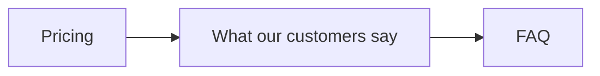
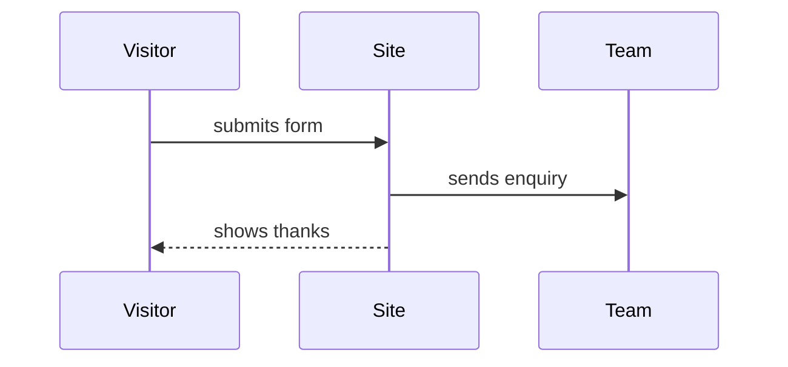
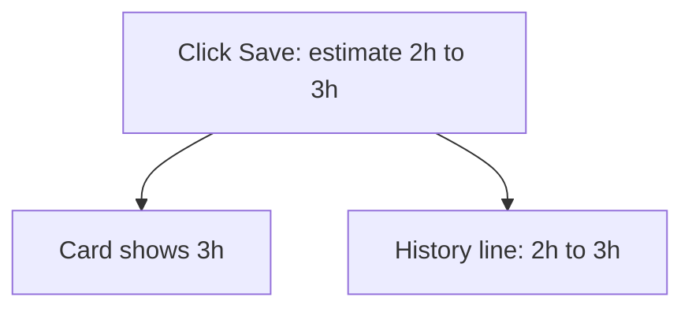

# Visuals in a spec

Part of the `kodion-create-spec` skill. Used in Step 4, when writing Part A.

**Why this file exists:** reviewing a spec took too long, because the reviewer had to read
everything before knowing whether to approve. A small picture at the top answers "what is this,
and is it safe?" in one look.

---

## The one rule that matters

> **A visual must save the reviewer words, never add them.**

If a drawing doesn't remove at least as many lines of text as it takes up, don't draw it.
A spec that is harder to read than before has made the problem worse, not better.

---

## What every spec gets

| | |
|---|---|
| **Always** | The **At a glance** box (below). Small spec and full spec alike. |
| **Plus** | **At most one** other visual from the menu, picked for this task. |
| **Never** | Two or more drawings. Three things to read is not "one view". |

If no visual from the menu fits, use none. The At a glance box alone is already most of the win.

---

## Hard limits

1. **The At a glance box is always plain text** — `│ ─ ┌ ┐ └ ┘` and ordinary letters. It is eight
   facts, not a picture, and it must read the same in the Claude Code session, on the Task Board,
   in a text message and in a GitHub preview. Never a Mermaid block, never HTML, never an image.
2. **The one drawing is a Mermaid block**, with a plain-text copy under it when the project asks
   for one (section 2 decides). Still never HTML and never an image file.
3. **Width 70 characters or less** for the box and for any text copy. Longer lines wrap and the
   drawing falls apart.
4. **At a glance box: exactly the 8 rows below. The drawing: 14 lines or fewer** (either form).
5. **Plain words inside the drawing too.** Screen names and user words, never file names,
   component names, table names or code. (Blocker B4 covers the drawings as well.)
6. **No new facts.** Everything in a visual is already in the spec. A drawing is a shortcut to
   what's written, not an extra place to look.
7. **Real values, not labels.** "6 seconds", "2h → 3h", "375 px phone" — not "the right delay".

---

## 1. At a glance (always, at the very top of Part A)

Eight fixed rows. One line each — if it doesn't fit the line, it's too long for the box.
Never leave a row blank: write "none" or "nothing".

```
┌─ AT A GLANCE ─────────────────────────────────────────────────────┐
│ Goal     <the one outcome, in the user's words>                   │
│ Changes  <what a user will see change, and where>                 │
│ Won't    <what people may expect but isn't included>              │
│ Keep     <what must not change, e.g. header, checkout>            │
│ Danger   <the worst thing that must never happen, or none>        │
│ Size     <n> reqs · <n> checks · <n> places · <risk> risk         │
│ Needs    <blocking questions + who answers, or nothing>           │
│ Verdict  <Ready to approve · check D1, D3 | Blocked by Q2>        │
└───────────────────────────────────────────────────────────────────┘
```

| Row | What goes in it |
|---|---|
| **Goal** | The one outcome, in the user's words. Not "build X" — what the user gets. |
| **Changes** | What a user will see change, and where. |
| **Won't** | The main thing people may expect that isn't included this time. |
| **Keep** | What must not change. This is the safety line; never write "nothing" here unless truly nothing is at risk. |
| **Danger** | The worst thing that must never happen, or "none". |
| **Size** | `<n> reqs · <n> checks · <n> places · <risk> risk`. |
| **Needs** | The questions that block, with who answers, or "nothing". |
| **Verdict** | See the table below. |

**Verdict row — what to write:**

| Situation | Write |
|---|---|
| No question blocks Planning | `Ready to approve · check D1, D3` (list the §9 rows) |
| No questions and no decisions | `Ready to approve · nothing to check` |
| A question blocks Planning | `Blocked by Q2 (client) · answer it, then approve` |

**This box is the review.** Everything under it — the tables in Part A, and all of Part B — is
there for when a row in the box looks wrong. That's the whole trade: the spec file is about ten
lines longer than before, and the part someone has to read drops from about sixty lines to ten.


---

## 2. Pick one drawing (or none)

Pick by what the task actually is. **One only.** If none of these fits, use none — the At a
glance box is already most of the win, and most small specs need no drawing at all.

| Task looks like | Use | Mermaid shape |
|---|---|---|
| A step order changes, or something new sits inside an existing journey | **A. Flow** | `graph LR` |
| Something travels between people or systems (a form that emails the team) | **B. Journey** | `sequenceDiagram` |
| A bug fix, or a refactor that must change nothing | **C. Before → after** | `graph TD` |
| One screen's look changes (text, colour, layout, a new field) | **D. Output preview** | plain text — no Mermaid shape fits a wireframe |
| The same thing shows up in 3 or more places | **E. Places list** | plain text — it's a list, not a diagram |
| Anything else, or you're unsure | **none** | — |

### Does it get a text copy under it?

A Mermaid block renders as a diagram in VS Code's preview (with the Markdown Preview Mermaid
Support extension), on GitHub, and in the Claude app. In the **Claude Code session it shows as
code**. So whether a text copy is worth its lines depends on where this team reviews, which is a
project fact, not something you can detect.

**Read `.claude/spec-visuals`** (one line, committed):

| File says | What to write |
|---|---|
| `mermaid` | The Mermaid block only. Everyone here reviews somewhere that renders it. |
| `mermaid+text` | The Mermaid block, then a plain-text copy under it. |
| the file is missing | Use `mermaid+text`, and ask once — see below. |

**Asking once** (only when the file is missing and you are already asking questions in Step 3, so
it costs no extra round): add *"Does your team review specs in VS Code preview or on GitHub, where
a Mermaid diagram renders — or in the Claude Code session, where it shows as code?"*
— **It renders (diagram only)** / **Add a text copy too** (recommended). Then offer to save the
answer to `.claude/spec-visuals` so nobody is asked again. If the question isn't asked, use
`mermaid+text` and say so in one line.

### Generating the text copy

**If `mermaid-ascii` is on the machine, never hand-draw the copy** — generate it, so the diagram
and the text can't disagree:

```
mermaid-ascii -f <scratch file>.mmd -x 2 -y 1 --max-width 70
```

Write the Mermaid source to a scratch file, run that, and paste the output into a plain fenced
block under the Mermaid block. Measured sizes, so you know what to expect:

| Shape | Width | Lines |
|---|---|---|
| `graph LR`, 3 boxes | 48 | 5 |
| `graph TD`, one cause → two effects | 61 | 11 |
| `sequenceDiagram`, 3 short messages | 37 | 13 |

If the command isn't found, draw the copy by hand in the same shape, keep it inside 70 characters
and 14 lines, and add one line to the Step 6 reply: *"`mermaid-ascii` isn't installed, so the text
copy is hand-drawn. `go install github.com/AlexanderGrooff/mermaid-ascii@latest` keeps the two in
step automatically."* Say it once, never as a question, and never let it stop the spec.

### What the tool can and can't draw

Stay inside this, or the text copy won't match the diagram:

- **Yes:** `graph LR` and `graph TD`, labelled edges (`A -->|label| B`), chained edges, dotted
  `-.->` and thick `==>`, `classDef`/`class` colouring, and `subgraph`.
- **Yes:** `sequenceDiagram` with `participant X as Name`, solid and dotted messages,
  self-messages, `Note over`, and `loop` / `opt` / `alt` blocks.
- **No:** any shape other than a rectangle (no `A(round)`, no `A{diamond}`), diagonal arrows,
  activation boxes, class diagrams and state diagrams.

### A. Flow — `graph LR`

````

````

Rendered, and the text copy if the project asks for one:

```
┌─────────┐  ┌────────────────────────┐  ┌─────┐
│         │  │                        │  │     │
│ Pricing ├─►│ What our customers say ├─►│ FAQ │
│         │  │                        │  │     │
└─────────┘  └────────────────────────┘  └─────┘
```

Rules: **6 boxes at most** — beyond that it isn't a flow any more, write it as steps. Box labels
are what a user would call the thing. If the new thing needs explaining, put up to three bullets
under the drawing instead of cramming the boxes.

### B. Journey — `sequenceDiagram`

````

````

Rules: **three actors and three messages at most**, and every message label is **two or three
words**. Longer labels run past the columns and the drawing grows past 14 lines — measured: three
short messages come to 13 lines, the same three with sentence-length labels come to 18.

### C. Before → after — `graph TD`

````

````

Rules: one cause at the top, **at most three visible effects** under it. Each box is something a
user can see, with real values. For a refactor, every effect box says "same as today" — that is
the point of the drawing.

### D. Output preview — plain text, no Mermaid

```
What the user sees after this change:

  ┌─────────────────────────────────────────┐
  │  "Bluespond cut our no-shows by half."  │
  │  Customer A, Pune                       │
  │                                         │
  │  ◀   ⏸   ▶        • ○ ○                 │
  └─────────────────────────────────────────┘

  Grey background · quote changes every 6 seconds · pause button first
```

Rules: one box, one screen or part. Rough shapes and real text, not a pixel design. One line of
notes under it. Never use it to decide design — it only shows what §4.3 already says. **No
Mermaid version:** the tool can't draw a wireframe, so this one has no diagram form and no text
copy question. When the task has a screenshot, draw this from what the image actually shows.

### E. Places list — plain text, no Mermaid

```
Where it appears (4 places)
  Home page, desktop ..... grey section between Pricing and FAQ   AC-01
  Home page, phone ....... full width, one quote                  AC-02
  Reduce motion is on .... starts paused, no sliding              AC-07
  Screen reader .......... announces "Quote 2 of 3"               AC-12
```

Rules: one line per place, with the check that proves it. This replaces §4.4's "Where it
appears" table in Part A — don't print both. It's a list, so it has no diagram form either.

---

## 3. Reply shortcuts (always, at the end of Part A)

So the reviewer doesn't have to compose a message:

```
**To reply:** `approve` · or `D1 change: <what instead>` · or `Q2: <your answer>`
**Not sure?** Open Part B for the detail behind any row above.
```

**A small spec gets the first line only** — it has no Part B to point at. Leave out any `D<n>` or
`Q<n>` that the spec doesn't actually have.

---

## 4. What not to draw

- **No architecture, no boxes for servers, databases, APIs or components** — even though Mermaid
  makes it easy. Plan mode draws those in §13 if it wants to. Part A is for people who don't read
  code.
- **No decoration.** No banners, no emoji rows, no ASCII art titles.
- **No timelines or estimates.** The spec says what, not when.
- **No repeat of a table.** If a visual says it, delete the sentence that also said it.
- **Nothing in Part B or Part C.** Visuals live in Part A only, where the review happens.
- **No second diagram "just for the plan".** If plan mode wants one, it draws its own in §13.
