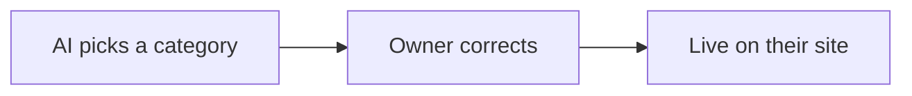

# CPH's real categories

`546` · Feature · Medium size · **High risk** — writes to a store's live Shopify (products and tags) and stores a new per-store setting
**Status:** Approved · 2026-10-30 · **Approved by:** navtej0110, 2026-10-30 · **Skill:** kodion-create-spec v2.6.0
**Task:** `.claude/tasks/546/task.json` · **Branch:** `feature/546-cphs-real-categories` (created by /start-task) · **Depends on:** CPH's Shopify connection, for the second testing stage only (Q1) · **Follows:** none
**Based on:** the task description · the client quote for this item · `CPH-CATEGORY-MAPPING.md` (CPH's real category structure, both research passes) · `PER-STORE-CATEGORIES.md` (what is already built, and its §8 gap list) · the upload, analysis and Shopify-placement code · no screenshots

> **Reviewer:** read the box. If every row looks right, reply **approve** — anyone can approve, at
> any risk. If a row looks wrong, the tables below and Part B have the detail. Part C is for plan mode.

---

# Part A — Review this

```
┌─ AT A GLANCE ─────────────────────────────────────────────────────┐
│ Goal     A product lands in the right category on their own site  │
│ Changes  Only the text of each row in the existing category box   │
│ Won't    No settings screen · no new fields · no brand placement  │
│ Keep     Standard categories · price, points · no-Shopify stores  │
│ Danger   Wrong category written, or a product losing its tags     │
│ Size     12 reqs · 31 checks · 4 places · High risk               │
│ Needs    nothing to start · Q1, Q2 block the CPH stage (client)   │
│ Verdict  Ready to approve · check D1 to D7                        │
└───────────────────────────────────────────────────────────────────┘
```



```
┌────────────────────┐  ┌────────────────┐  ┌───────────────────┐
│ AI picks a category├─►│ Owner corrects ├─►│ Live on their site│
└────────────────────┘  └────────────────┘  └───────────────────┘
```

- The list the AI picks from is the store's **own** Shopify categories, read as the photo is uploaded.
- Brand and catch-all categories are kept from the AI by a per-store setting **we** put in the database — no screen.
- Saving adds the product to the chosen category, whether it is hand-kept or fills itself from rules.

## 1–3. Summary
**Why:** A store's products currently arrive on its own Shopify with no category, so they are invisible from the store's own navigation — CPH navigates entirely by category. Most of this feature is already built and working; what is left is the five things that still get it wrong, every one of them a case CPH's real store actually has.
**Quality:** 90 / 100 · no blockers

## 4.3 Requirements
| ID | Requirement | Priority | Source |
|---|---|---|---|
| FR-01 | The categories offered come from the connected store's own Shopify, read for that store at upload time and never from our own database. This work adds no store name, category name, handle, brand or language test to the code it touches. | Must | Task description |
| FR-02 | The AI picks exactly one category, or none when nothing fits. None is always allowed and is always better than a wrong pick. | Must | Task description |
| FR-03 | The store owner sees the pick before publishing and can change it to any offered category, or to none. | Must | Task description |
| FR-04 | On save the product is really added to the chosen category on that store's Shopify: added directly when the category is hand-kept; given the tags the rules need when the category fills itself from tag rules, honouring whether *all* rules or *any one* must match, and **adding** to the product's tags rather than replacing them. A category whose rules are not about tags is never suggested. | Must | Task description |
| FR-05 | Which kind of category it is must be read from Shopify at the moment of syncing, never taken from what was stored at upload time. | Must | Task description |
| FR-06 | A category marked "don't suggest" — a store's brand and catch-all ones — is never offered to the AI. On top of that, a category named exactly after the product's own brand is refused automatically, as it is today. | Must | Your answer |
| FR-07 | The "don't suggest" marks are stored per store in the database and set by us as a one-time setup, the same way a store's Link plan flags are set. **No screen is built** — not for the owner, not for admins — and a change to the marks applies to the next upload. | Must | Your answer |
| FR-08 | Anything shown — to the AI, and in the existing category box on the upload form — to tell two similar categories apart describes what is really inside that category, in the store's own words. The URL handle is never shown. | Must | Task description |
| FR-09 | The product type written to Shopify uses the store's own spelling for that type, exactly as they already write it, including a typo. Where the store has never used that type, our standard wording is written, as today. | Must | Task description |
| FR-10 | The platform's standard category list is not changed or replaced, and a store's own categories never reach similar-item search, price suggestions or points. | Must | Task description |
| FR-11 | A store with no Shopify connected of its own — including an unclaimed store — a consignor or brand account, and a guest in "try it free" behave exactly as they do today. | Must | Task description |
| FR-12 | Checked on our own test store first — duplicate titles, a handle that contradicts its contents, brand categories, catch-alls, and categories of both kinds — and only then on CPH's real store. | Must | Task description |

<sub>Must = can't ship without it · Should = soon after · Could = nice to have · Source "AI" = my suggestion, please check it</sub>

## 9. Decisions I made — please check
| # | Decision | Why |
|---|---|---|
| D1 | A category marked "don't suggest" is still choosable by the owner by hand; it is only kept away from the AI. | The task says these must never be *offered to the AI*. Nothing on the form is taken away from the owner. |
| D2 | In place of the handle, each row shows the garment types actually inside, in the store's **own** words — e.g. "mostly jakke · 87 products". Not translated. | CPH's handles actively lie (PRADA's says shirts). Translating their Danish types into English would be the language rule the task forbids. |
| D3 | Reading what is inside each category is **one extra read per store**, held in the same 10-minute per-store cache the category list already uses — never a read per upload or per category. | The existing category read returns no products at all, so there is no other source for "what is really inside". Reading per upload would slow every upload. |
| D4 | Tags needed by a rule-filled category are **added** to whatever tags the product already has, never replacing them. | Every category on our shared base store fills itself from tags. Replacing tags would empty those and drop products out of the base store's categories. |
| D5 | The existing automatic refusal of the product's own brand category stays, on top of the marks. | It already works, costs nothing, and is store-neutral — a second safety net for the case the task calls out (the brand is legible in the photo). |
| D6 | Rollback is reverting the release, not a feature switch. | This project has no feature-switch mechanism, and inventing one would be scope nobody asked for and nobody has tested. |
| D7 | A category whose rules are not about tags keeps the "— automatic" marker the box already shows today. No new wording is introduced anywhere. | The scope for this task allows only one text change: the handle being replaced by what is inside. The marker already exists, so it is reused rather than reworded. |

## 10. Questions for you
| # | Question | Blocks | Who answers |
|---|---|---|---|
| Q1 | CPH's Shopify has to be connected (their owner approves the link) before the second testing stage can run. When can that happen? | Going live | Client |
| Q2 | Which of CPH's categories do we mark "don't suggest"? The research gives 19 of their 34: **13 brand categories and 6 catch-alls**, every one named with its title and handle in §8, keyed on the Shopify id so a rename can't drop it. Confirm that list before their first upload — nobody can change it from a screen. | Going live | Client |

**To reply:** `approve` · or `D1 change: <what instead>` · or `Q1: <your answer>`
**Not sure?** Open Part B for the detail behind any row above.

---

# Part B — Details (open if needed)

<details>
<summary><b>4.1 Who uses it · 4.2 Key information</b></summary>

### 4.1 Who uses it
| Who | What they can do |
|---|---|
| Store owner (role `store`), with their own Shopify connected | Uploads a product, sees the suggested category in the box that is already there, and changes it or clears it. Nothing new to open, nothing new to fill in. |
| Store owner with no Shopify connected | No category box. Exactly as today. |
| Consignor / brand | Uploads as today, with **no category box** — the category list is only ever read for the signed-in owner of a connected store, and a consignor does not own one. |
| Admin / developer | **No screen.** The "don't suggest" marks are put into the database directly, per store, as part of setting that store up. The existing category check page used to verify a connection is unchanged. |
| Guest ("try it free") | No category box at all, exactly as today. |

### 4.2 Key information
| Item | What it holds |
|---|---|
| The store's categories | Read from the store's own Shopify, at most 10 minutes old, and never copied into our database. A merchant can rename or delete one at any moment. |
| What is inside each category | The garment types actually found in a sample of that category's products, in the store's own spelling. Read once per store and cached (D3). Used to tell two similar categories apart, and to get the store's own spelling for FR-09. |
| The chosen category | Saved on the product as a snapshot of what the owner picked. Anything acting on it re-reads the real category from the store first. |
| "Don't suggest" marks | Per store, the categories the AI is never offered. Set by us in the database; the only thing this feature stores of its own. |

</details>

<details>
<summary><b>4.4 Where it appears and its life (4 places · 7 stages · tester checklist)</b></summary>

### 4.4 Where it appears and its life

**Where it appears**
| Place | What the user should see | Check |
|---|---|---|
| Add a product → the category box that is already there (store dashboard) | The same control in the same place. Each row now says what is actually inside the category instead of showing a URL handle. The AI's pick is already selected, "None" is still there, and a marked category can still be picked by hand. | AC-01, AC-03, AC-12, AC-13, AC-15, AC-17, AC-18, AC-26, AC-29 |
| The store's own Shopify and live website | The saved product sits inside the chosen category; its product type reads in the store's own spelling. | AC-07, AC-08, AC-09, AC-19, AC-20, AC-30 |
| Upload on a store with no Shopify, an unclaimed store, a consignor account, and "try it free" | No category box, every other field exactly as today. | AC-22, AC-24 |
| Admin → the existing category check page | Unchanged. Still the way a connection is verified before a store is handed the link. | AC-25 |

**Life of the item**
| Stage | What should happen | Check |
|---|---|---|
| Analyse (photo uploaded) | One category pre-selected, or none. Never a marked category, never the product's own brand. | AC-03, AC-04, AC-12, AC-14 |
| Owner corrects before saving | The saved product goes where the owner left the box, not where the AI pointed. | AC-05, AC-06 |
| Save (create) | Placed on the store's Shopify by the right mechanism for that category's kind, read fresh at that moment. | AC-07, AC-08, AC-09, AC-11 |
| Save can't place it | The product is still created and recorded, the owner sees no error, the reason is logged under `[collection]`. | AC-10, AC-21 |
| We change a store's marks in the database | The next upload already respects the change. | AC-16 |
| Edit an existing product | Its category is not changed, duplicated or removed, and its tags are not stripped. | AC-28 |
| Delete a product | Exactly as today. Nothing new is removed from any category. | AC-28 |

**What testers usually find missing**
| # | Question | Answer |
|---|---|---|
| C1 | Still there after a page refresh or on another device? | Yes — the marks live in the database per store, so they are the same in every browser and after any refresh (AC-16). The chosen category is saved on the product. |
| C2 | A new status or type has its own colour, badge, filter option and legend entry? | N/A — these are the store's own categories, shown in a plain list that already exists. Our app gives them no colour, badge, filter or legend. |
| C3 | No word or label shown twice? | Yes — today the row reads `Jakker (jakker-1)`, repeating the name and adding a misleading handle. After the change the name appears once, followed by what is inside it (AC-17, AC-18). |
| C4 | Timers, tracking, counters, notifications and emails start and stop when they should? | N/A — nothing is timed, counted, notified or emailed. Every placement outcome is written to the log only. |
| C5 | Validation, empty state and error message covered? | See §5 — 10 situations, each with a check. |
| C6 | Same rules on every screen (who can see or edit it)? | Yes — the store is always worked out from who is signed in, never from anything the browser sends, so no owner can read another store's categories (AC-23). The marks are not reachable from any screen at all. |

</details>

<details>
<summary><b>5. When things go wrong (10 situations)</b></summary>

## 5. When things go wrong
| Situation | What the user sees | Check |
|---|---|---|
| Store has no Shopify connected of its own | No category box. Every other field and result exactly as today. | AC-22 |
| Shopify can't be reached, or the store's key fails, while listing categories | No category box. The upload carries on and finishes normally; the reason is logged. | AC-21 |
| The store has no categories at all | No category box, and the upload is exactly as it is for a store with no Shopify. | AC-21 |
| What is inside a category can't be worked out (that read failed) | The row shows the category's name on its own — never a handle — and the AI is given the name on its own too. | AC-17 |
| Every category is marked "don't suggest" | No category is pre-selected. The owner may still pick one by hand. The upload finishes normally. | AC-26 |
| Nothing in the store fits the garment | Nothing pre-selected; the box reads "None — don't add to a collection", as today. | AC-04 |
| Two categories still look alike after showing what is inside them | Nothing is pre-selected and the owner chooses. A wrong category is worse than none. | AC-18 |
| The chosen category was deleted in Shopify between upload and save | The product is still created and recorded. It is placed nowhere, and the reason is logged. | AC-10 |
| The category fills itself from rules that are not about tags (e.g. a price rule) | The row keeps today's "— automatic" marker, and the AI is never offered it. The product is created and left unplaced. | AC-13 |
| Placing the product times out (15 seconds) or Shopify refuses it | The product is still created and recorded, with no error shown to the owner. The reason is logged. | AC-10 |

</details>

<details>
<summary><b>6. How we know it's done (31 acceptance checks)</b></summary>

## 6. How we know it's done

**How the model-dependent checks are run.** AC-03, AC-04, AC-12 and AC-14 depend on an AI answer, which is not identical every run. Each is run **5 times on the same photo** and must give the stated result every time; a single miss is a fail and is recorded with the photo used. There is no test runner in this project, and `npm run lint` and `npm run build` are both broken on this host (`.claude/rules/known-failures.md`), so every check below is a manual one. Proof for §14 is the command output, a screenshot of the store's Shopify admin, or the named log line.

| ID | Given / When / Then | Covers |
|---|---|---|
| AC-01 | Given our test store, when a photo is uploaded, then the box lists that store's own categories as read from its Shopify (at most 10 minutes old), and no category belonging to any other store or to the base store appears. | FR-01 |
| AC-02 | Given the files this task changes, when they are read, then none contains a store name, a category name, a handle, a brand name or a test on Danish or English. (The brand list already in `src/lib/taxonomy.js` serves other features and is neither used nor extended here.) | FR-01 |
| AC-03 | Given a photo of a jacket and a store that has "Jakker", when analysis finishes, then exactly one category is pre-selected and it is a "Jakker". | FR-02 |
| AC-04 | Given a photo of a dress and a store with no dress category, when analysis finishes, then nothing is pre-selected and the box reads "None — don't add to a collection". | FR-02 |
| AC-05 | Given the AI pre-selected "Jakker", when the owner changes the box to "Bluser" and saves, then the product is in "Bluser" on their Shopify and not in "Jakker". | FR-03 |
| AC-06 | Given the AI pre-selected "Jakker", when the owner changes the box to "None" and saves, then the product is created, placed in no category, and the upload reports success. | FR-03 |
| AC-07 | Given "Jakker" (hand-kept) is chosen, when the owner saves, then the product appears inside "Jakker" in the store's Shopify admin and on that category's page on the live site. | FR-04 |
| AC-08 | Given "Men's shirt" on our test store, which fills itself from `tag = shirt` **and** `tag = men`, when the owner saves, then the product carries both tags and appears in "Men's shirt". | FR-04 |
| AC-09 | Given a category on our test store that fills itself from **three** tag rules of which **any one** matches, when the owner saves, then the product carries the tag for one of those rules, appears in the category, and does not carry the other two. | FR-04 |
| AC-10 | Given Shopify refuses, times out (15 seconds), or the category was deleted since the upload, when the owner saves, then the product still exists on Shopify and in our records, the owner sees no error, and a `[collection]` line names the product and the reason. | FR-04 |
| AC-11 | Given "Jakker" was hand-kept when the photo was analysed and is switched to rule-filled in Shopify before the owner saves, when the owner saves, then placement uses tags, not a direct add — proving the kind is read at save time and not taken from the upload. | FR-05 |
| AC-12 | Given "STUSSY", "PRADA" and `all` are marked "don't suggest" for that store, when a Stussy jacket is analysed 5 times, then none of the three is ever pre-selected and "Jakker" is. | FR-06 |
| AC-13 | Given a category that fills itself from a rule that is not about tags (e.g. price), when the owner opens the box, then its row carries the same "— automatic" marker it does today and it is never pre-selected. | FR-04, D7 |
| AC-14 | Given a Prada shirt and a store whose "PRADA" category is not marked, when it is analysed, then "PRADA" is not pre-selected — the existing automatic own-brand refusal still holds. | FR-06 |
| AC-15 | Given `all` is marked "don't suggest", when the owner opens the box, then `all` is still there for them to pick by hand, and picking it places the product there. | FR-06, D1 |
| AC-16 | Given a store's marks in the database, when one is added or removed and a photo is uploaded straight afterwards, then that upload already respects the change, and the marks read the same in every browser with no screen involved. | FR-07 |
| AC-17 | Given two categories both titled "Jakker", when the list is shown to the AI and in the box, then each row describes what is actually inside it in the store's own words (e.g. "mostly jakke · 87 products" and "no products yet"), so the two can be told apart; and given that read failed, then each row shows the name alone and never a handle. | FR-08 |
| AC-18 | Given "PRADA" whose handle is `skjorter`, when the owner opens the box, then no row anywhere shows a handle, and nothing in PRADA's row reads "skjorter" or "shirts". | FR-08 |
| AC-19 | Given the store already writes the type `accesories` on its own products, when a belt is saved, then the product type written to Shopify is exactly `accesories`. | FR-09 |
| AC-20 | Given the store uses both `t-shirt` (75 products) and `T-shirt` (9), when a t-shirt is saved, then the product type written is `t-shirt`, in that exact case; and given a type the store has never used, then our standard wording is written. | FR-09 |
| AC-21 | Given the store's category read fails or returns nothing, when a photo is analysed, then the question sent to the AI is **identical** to the one sent for a store with no Shopify at all, the upload completes with no category, and the reason is logged. | FR-01, FR-11 |
| AC-22 | Given a store with no Shopify connected, an unclaimed store, and a guest in "try it free", when a photo is analysed, then no category box appears and the question sent to the AI is identical to the one sent before this change. | FR-11 |
| AC-23 | Given a second store owner's id is put into the upload requests by hand, when they are sent, then only the signed-in owner's own categories are ever read. | FR-01, C6 |
| AC-24 | Given a consignor or brand account uploads a product, when analysis finishes, then there is no category box and the result matches today's behaviour. | FR-11 |
| AC-25 | Given a product is uploaded on a connected store, when the base store is inspected afterwards, then nothing was created, placed or tagged on the base store, and the admin category check page still works as before. | FR-10, FR-11 |
| AC-26 | Given every category on the store is marked "don't suggest", when a photo is analysed, then nothing is pre-selected, the owner can still pick by hand, and the upload finishes normally. | FR-06 |
| AC-27 | Given the whole change is finished, when the standard category list file is compared with the version before it, then it is identical; and when the text used for similar-item search, the price query and the points calculation is read, then the store's category appears in none of them. | FR-10 |
| AC-28 | Given a product already placed in "Jakker" with existing tags, when the owner edits and saves it again, and separately when they delete it, then its category is not duplicated, moved or emptied, its existing tags are still there, and both behave as they do today. | FR-04, FR-10 |
| AC-29 | Given the whole change is finished, when every screen is compared with today's, then the only difference anywhere is the text of each row inside the existing category box: no new screen, no new page, no new field, and no row removed from that box. | FR-07 |
| AC-30 | Given our own test store is set up with duplicate titles, a handle that contradicts its contents, brand categories, catch-alls and categories of both kinds, when the full flow is run there, then every other check in this table passes there — **before** CPH is connected. Then the same run on CPH's store places a real product inside the chosen category on cphconcept.com, and that test product and its tags are removed afterwards. | FR-12 |
| AC-31 | Given a marked category, when it is renamed in Shopify and its handle changed, then it is still not offered to the AI — proving the mark is held against the category's Shopify id and not its title or handle. And given a mark for an id that no longer exists on the store, then every other mark still applies and the upload is unaffected. | FR-07 |

</details>

<details>
<summary><b>7. Safety & security (10 apply · 6 not involved)</b></summary>

## 7. Safety & security

| Area | What we do |
|---|---|
| User input / forms | No new input anywhere. The category coming back from the upload form is already whitelisted down to known fields with a real category id, and stays so. The marks are not reachable from any form. |
| Showing text safely | Category names are the merchant's own free text and may contain quotes or line breaks, and so are the garment types we now show beside them. All of it is shown as plain text, and the list handed to the AI keeps each category on exactly one row so one name can never read as several. |
| Login & permissions | The store is always worked out from who is signed in. Nothing the browser sends decides whose categories are read (AC-23). The marks have no screen, so there is no new permission to get wrong. |
| Secrets & keys | The store's Shopify key stays encrypted and server-side. Nothing new about it reaches the browser. |
| Stored data | One new per-store setting (the marks), written by us directly, plus the existing category snapshot on a product. **Nothing existing is changed or migrated:** a store with no marks behaves exactly as stores do today, and existing products are untouched. A mark whose category has since been deleted in Shopify is simply never matched and is harmless. |
| Performance | The category list keeps its existing 10-minute per-store cache. Reading what is inside each category is **one extra read per store**, held in that same cache — never per upload, and never one read per category per upload (D3). An upload must not get measurably slower. |
| Breaking other features | The standard category list, similar-item search, price suggestions, points and size handling stay untouched — the store's category never reaches the text we build embeddings from or the search pre-filter (AC-27). The base store must never be created on, placed in or tagged for a connected store's product (AC-25). **Tags are added, never replaced** (D4) — replacing them would drop products out of the base store's own tag-ruled categories. Adding a tag can also pull the product into another rule-filled category that uses the same tag; that is accepted, and only the tags the chosen category's rules require are added. |
| Errors & logging | Placing a product can never fail the upload: the product already exists on Shopify by then. Every outcome is returned as a status and logged under the existing `[collection]` prefix with the product id and the reason. The owner is never shown an error for a category problem. |
| Mobile & browsers | The category box is the one that is already there, so nothing new has to be laid out. The longer row text must still read on a 375 px phone without breaking the control, on current Chrome, Safari, Firefox and Edge. |
| Rollback | **Revert the release** (D6 — this project has no feature switch): the box returns to its old row text, placement returns to today's behaviour, and the stored marks are simply unread. **A rollback does not undo what was already written to the store's Shopify** — a product already placed in a category, and any tag already added, stay there. Both are visible and reversible by the merchant in their own Shopify admin. The rollback steps must say this, and must be tested before release. |

**Not involved (checked):** personal data (none read or written) · legal / honesty (no claims, prices or consent wording) · payments & money (none) · deleting anything (nothing is deleted; a product is never removed from a category) · accessibility (no new control — the existing box keeps its label, keyboard behaviour and focus outline; only its row text changes) · SEO (our own pages are unchanged — the store's own category pages gaining products is the point of the task, on their site, not ours).

</details>

<details>
<summary><b>8. Rules & limits</b></summary>

## 8. Rules & limits
- Follows the project's existing rules in `CLAUDE.md` and `.claude/rules/`.
- All prices stay in DKK. Nothing about money changes.
- **Scope is the quote, and nothing more.** The client quoted only: *"CPH's real categories: we fetch CPH's categories directly from their Shopify store, so the AI picks from their actual categories. Products then appear in the right place on their live website."* No settings screen, no admin page, no new field and no other UI was quoted or agreed. The **only** visible change permitted here is the text of each row inside the category box that already exists — same control, same position, same behaviour (AC-29).
- **Out of scope, recorded here as decisions rather than gaps:** an owner-facing category settings screen (a separate follow-up task if more stores need it) · automatic brand placement · the Men/Women choice · moving a product's category after it has been saved · segment placement.
- **The 19 CPH categories to mark "don't suggest"** (from `CPH-CATEGORY-MAPPING.md` §1, of their 34). Because these are set by hand and a wrong list fails silently, each is recorded by **title and handle**, and the mark itself is stored against the category's Shopify id — so a category that is renamed, or whose handle changes, stays marked.
  - **13 brand categories:** SUPREME (`t-shirts`) · PRADA (`skjorter`) · CHANEL (`chanel`) · GUCCI (`sweatshirt`) · BAPE (`jakker`) · PALACE (`bukser`) · STONE ISLAND (`hoodies`) · MIU MIU (`miu-miu`) · CHROME HEARTS (`chrome-hearts-1`) · MAISON MARGIELA (`maison-margiela`) · STUSSY (`stussy`) · COMME DES GARCONS (`sko`) · BURBERRY SCARF (`burberry-scarf`).
  - **6 catch-alls:** "Nye produkter" (`mini-drop`) · "Alle produkter" (`alle-produkter`) · "Kesi´s" (`kesi-s`) · "Vores favoritter" (`our-pics`) · `all` · `archive`.
  - Note how badly the handles mislead: SUPREME's says t-shirts, PRADA's says shirts, GUCCI's says sweatshirt, BAPE's says jackets, COMME DES GARCONS' says shoes. This is the same trap FR-08 removes from the box, and the reason the marks are keyed on the id.
  - **35 is a different number.** The research's "35 brands" (§2) counts *vendors in the catalogue*, of 53 in all — not categories. Only 13 of their categories are brand ones, and only categories can be marked.
- **Known limit, accepted:** CPH's top menu is their segment categories, and their garment-type categories are reachable only from their filter sidebar. With one category picked, a product will be in the right category but still not in their top menu. Segment placement needs either a hardcoded brand-to-segment list (which this task forbids) or a choice by the uploader, so it belongs to that follow-up.
- **Known limit, unchanged:** one read returns at most 250 categories, and they are shown in the order Shopify returns them — exactly as today. Neither is touched here.
- Where `CPH-CATEGORY-MAPPING.md` §6.3 goes further than this task — four separate signals, and placing a product in a segment and a brand category as well as a type one — that is deliberately out of scope. Its §6.0 hard constraint on the standard category list still applies in full.
- **Effort:** the whole category item was quoted at 2–3 hours. Five separate gaps remain and one of them (reading what is inside each category) needs a Shopify read that does not exist yet, so the plan should order the work so the highest-value gaps land first if the time runs short.
- Size was reduced from Large to Medium after this scope correction: no new screen and no new field. Risk stays High, so §5 and §7 are still filled in full.

</details>

<details>
<summary><b>11. What exists today</b></summary>

## 11. What exists today (as a user sees it)
Most of this feature already works, and the parts that do must keep working:

- A store owner with a connected Shopify uploads photos, and the AI already fills in the listing **and** picks one of that store's own categories, read live from their Shopify at that moment. Nothing about any store is hardcoded.
- The owner sees a "Shopify Collection" box with the AI's pick already selected, every other category of theirs, and "None". They can change it before saving. Categories that fill themselves from rules already carry an "— automatic" marker.
- On save, the product is created on their Shopify and added to the chosen category when that category is hand-kept. Which kind it is gets re-read from Shopify at that moment, so a category switched in the meantime is handled correctly.
- A store with no Shopify connected, a consignor account, and a guest in "try it free" see no category box and are unaffected.

**What still goes wrong — the five things this task is about:**
1. Catch-all categories ("Nye produkter", "Alle produkter", "Kesi´s", "Vores favoritter", "archive") are still offered to the AI. Only a written instruction in the prompt discourages them, and CPH's are in Danish, so nothing reliable stops a wrong pick.
2. Only the product's **own** brand category is refused. A Prada shirt can still be put into "GUCCI", because every other brand category is still offered.
3. Each category is shown — to the AI and to the owner — as its name followed by its URL handle, e.g. `PRADA (skjorter)`. On CPH those handles contradict the contents: PRADA's says shirts, SUPREME's says t-shirts, GUCCI's says sweatshirt. The one thing shown to tell two categories apart is the one thing that lies.
4. When the chosen category fills itself from rules, placement is skipped and the product is assumed to arrive by its existing tags. On our own base store **every** category works that way, so the owner's choice can silently do nothing.
5. The product type written to Shopify comes from our own standard list, not the store's own spelling. CPH spell it `accesories` on 71 products and use both `t-shirt` and `T-shirt`; their storefront filters are case-sensitive, so our spelling splits their filters.

**Things that could break:** the standard category list and everything that leans on it (similar-item search, price suggestions, points, size handling) · uploads on stores with no Shopify · the "try it free" guest flow · consignor and brand uploads · the shared base store, whose categories all fill themselves from tags, and whose products must keep the tags they have · existing products already placed in a category · the upload never failing because of a category problem.

**Attachments:** none — the task has no screenshots or files.

</details>

---

# Part C — For plan mode (no review needed)

## 12. Instructions for plan mode
Follow the **Full spec** section of `.claude/rules/plan-mode.md`.

| | |
|---|---|
| **Task** | `546` · plan file: `.claude/plans/546-cphs-real-categories.md` |
| **Type** | Feature |
| **Lessons that apply** | From `references/lessons-learned.md`: **L1** — the chosen category is editable, so check it at every step, including after saving and on a re-edit (AC-28). **L2, L3, L4** — N/A: no new status or badge, not a small task, not a bug fix. |
| **Required for Risk High** | §5 covers all failure cases **and** what happens to existing data · all 16 safety areas answered · §4.1 required (done) · **a backup before coding, written as a plan step** · **written and tested rollback steps** · tested with real-like data · §14 full, with proof of the backup and of the rollback test. |
| **Also for this task** | **Build no screen.** §8 is binding: the only visible change allowed is the row text inside the existing category box, and AC-29 checks exactly that. The marks go into the store's own record in the database, set by hand per store — find how a store's Link plan flags are set today and follow that same pattern rather than inventing a new one. Read `PER-STORE-CATEGORIES.md` first; its §8 is the gap list this task closes. Reuse what exists (the live per-store read and its 10-minute cache, the whitelisting of the submitted category, the live kind check at save, `invalidateStoreCollections()`, the admin read-back route) and name what you reused in §13. **The existing category read returns no products** (`getAllCollections` fetches id, title, handle, description, updatedAt, sortOrder, productsCount and ruleSet only), so FR-08 and FR-09 need a second per-store read of what is inside each category — budget it per D3 and §7 Performance, never per upload. For FR-04, `ruleSet.rules` carries `column`, `relation` and `condition`, and `appliedDisjunctively` says whether any one rule or all of them must match; only `column: TAG` with `relation: EQUALS` is in scope, and everything else is the "automatic marker, never suggested" case (AC-13). `CPH-CATEGORY-MAPPING.md` §6.0 stands: the standard category list is not replaced, and a store's categories must never reach the embedding or vector-search path. The **backup** required above is an export of the existing `products.storeCollection` values plus the new marks, taken before release; nothing is migrated, so there is nothing else to restore. `npm run lint` and `npm run build` both fail on this host — see `.claude/rules/known-failures.md`; every check in §6 is manual, and §6's header says how the model-dependent ones are run. |

## 13. Technical summary

**Plan:** `.claude/plans/546-cphs-real-categories.md` (approved 2026-10-30)

**Stack, from the project's own files:** Next.js 16 App Router + React 19, JavaScript with JSX
(`jsconfig.json` alias `@/*` → `./src/*`), Mongoose 8 on MongoDB (`src/lib/db.js`), Shopify Admin
GraphQL **2024-10** (`BASE_STORE_API_VERSION`, `src/actions/shopifyAction.js:18`), OpenAI
structured output (`src/lib/aiProductAnalysis.js`), NextAuth v5 JWT sessions. Deployed on Vercel;
`vercel.json` raises `maxDuration` to 60 s for **`app/api/**` only**.

**Project scan — findings with proof:**

| Finding | Proof |
|---|---|
| No product-reading Shopify query exists anywhere in `src/`. `getAllCollections` returns collection metadata only. | `src/actions/shopifyAction.js:1868-1900` — selects id, title, handle, description, updatedAt, sortOrder, productsCount.count, ruleSet. FR-08 and FR-09 therefore need a new paginated product read. |
| No `tagsAdd`/`tagsRemove` anywhere; tags are written once, at create. | `src/actions/shopifyAction.js:168` (`formattedTags`) → `:183` (`productInput.tags`). |
| Rule-filled categories are currently **skipped** at save, not populated. | `src/actions/shopifyAction.js:1805-1811` returns `{status:"skipped", reason:"automated collection — populated by its own tag rules"}`. This is gap 4. |
| `productType` is a verbatim passthrough of our taxonomy's `subcategory`. | `src/actions/shopifyAction.js:180` and `:2020`; `normalizeSubcategory` falls through to the raw string (`src/lib/normalize.js:142-170`). This is gap 5. |
| The misleading handle is shown to both the model and the owner. | `src/lib/aiProductAnalysis.js:159-167` (`${title} (${handle})`) and `src/app/dashboard/add-product/components/ProductFormFields.jsx:101-105`. This is gap 3. |
| Catch-alls are discouraged only by prompt text; all brand categories except the product's own are still offered. | `src/lib/aiProductAnalysis.js:170-179` (prompt rules) and `:196-221` (`resolveStoreCollection` rejects only `title === brand`). Gaps 1 and 2. |
| `ShopifyStore` already holds fields that are schema-declared but never written by a screen, because both developer routes use explicit field whitelists. | `src/models/ShopifyStore.js:41-71`; whitelists at `src/app/api/developer/shopify-stores/route.js:73-90` and `.../[storeId]/route.js:22-37`. Safe home for the marks with no UI. |
| The resolver already `.lean()`s the whole store document, so a new field costs no extra query. | `src/lib/shopifyStoreResolver.js:51-57`. |

**Layers:** Frontend — one `<option>`'s text, no new control. Backend — ref-map filtering,
`tagRulesForCollection`, `addProductTags`, the `ruleSet` branch, the product-facts read, the
`subcategory` override. Data — one new field, `ShopifyStore.aiExcludedCollectionIds`, default `[]`,
no migration. Security — session-derived owner id, no browser-supplied tags or rules, base-store
write refused, merchant text JSON-encoded into the prompt. Integrations — Shopify Admin 2024-10,
`tagsAdd` under the already-granted `write_products`. Testing — no runner exists; all 31 checks are
manual (§6 header gives the protocol for the four model-dependent ones). Release — Vercel from
`master`; rollback is a release revert (D6).

**Risk:** unchanged at High. No new danger found; the scan confirmed the two already-logged issues
in `SECURITY-ISSUES.md` are out of this task's scope.

**Deviation from the approved spec — one, flagged for the reviewer:** spec **D3** says the
"what is inside each category" read is held in the existing 10-minute collection cache. The plan's
**P2** instead keeps it off the upload path entirely (cached separately, refreshed in the
background; an upload with no digest yet shows category names only). Reason: the read is a full
product crawl (CPH ≈ 602 products, 3 paginated calls), and running it inside `createProduct` — a
server action on a **page** route, outside `vercel.json`'s `app/api/**` 60 s override — would both
breach §7 Performance and risk the invocation being killed mid-create. Spec §5 already specifies
the fallback behaviour this relies on.

**Acceptance checks → where each is proven:** AC-01, AC-12, AC-15, AC-26, AC-31 → Stage 1
(marks + ref-map filter). AC-08, AC-09, AC-10, AC-11, AC-13 → Stage 2 (`tagRulesForCollection`,
`addProductTags`, the `ruleSet` branch). AC-17, AC-18 → Stage 3 (prompt block + `<option>` text).
AC-19, AC-20 → Stage 3 (`subcategory` override from the digest). AC-02, AC-29 → file-level review
of the diff. AC-03 to AC-07, AC-14 → unchanged behaviour, re-verified on the test store.
AC-21 to AC-25, AC-27, AC-28 → regression pass. AC-30 → the two-stage test-store-then-CPH run.
Full ordering, baseline, backup and rollback steps are in the plan's Verification section.

## 14. Done report

**Code complete; not yet validated.** Every check below is manual by nature (no test runner
exists, and `npm run lint` / `npm run build` are both broken on this host — same as the
known-failures list). What could be proven without a live Shopify store has been, with the proof
named. **The 20 checks marked ⏸ all need the connected test store**, which is the next step.

**Key:** ✅ Pass · ❌ Fail · ⏸ Not tested yet

### Proven now

| ID | Verdict | Proof |
|---|---|---|
| AC-02 | ✅ | Searched all 10 changed/new files for `cph`, `concept`, `jakker`, `alle-produkter`, `kesi`, `mini-drop`, `our-pics`, `danish`, `dansk`, excluding comments: no match in code. The brand list in `src/lib/taxonomy.js` is neither read nor extended here — that file is unmodified. |
| AC-27 | ✅ | `git diff --name-only`: `taxonomy.js`, `embeddings.js`, `normalize.js` and `suggest-price` are not modified. `grep storeCollection` over `embeddings.js`, `normalize.js`, `suggest-price/route.js`: no reference. Mongo still stores our own `subcategory` (`productActions.js:276`); the store's own spelling is applied **only** to the object handed to `createShopifyProduct` (`:172`), so points, price history and similar-item search are untouched. |
| AC-29 | ✅ | `git diff --stat -- 'src/app/**' 'src/components/**'`: one file, `ProductFormFields.jsx`, 7 insertions / 4 deletions. Stripping comment lines, the entire change is `{c.title} ({c.handle})` → `{c.title}` + `{c.contents ? ' — ' + c.contents : ''}`. No new screen, page, field or control; no row removed from the box. |

### Logic proven; the Shopify write still needs the test store

| ID | Verdict | What was proven, and how |
|---|---|---|
| AC-08 | ⏸ | Tag computation proven: `tagsAdd` receives both tags for a two-rule AND collection — 25-case run over `tagRulesForCollection` (scratch harness), including `{appliedDisjunctively:false, rules:[TAG shirt, TAG men]}` → `{mode:"all", tags:["shirt","men"]}`. The Shopify write itself is untested. |
| AC-09 | ⏸ | Same harness: three TAG rules with `appliedDisjunctively:true` → exactly one tag, the first as Shopify returned them, and the other two absent. Write untested. |
| AC-13 | ⏸ | A `TYPE`/`VENDOR`/`CONTAINS` rule returns `{eligible:false}`, so `canBeSuggested` withholds it from the model and `addProductToStoreCollection` returns `skipped` with the reason. That the row still shows the existing `— automatic` marker is untested in the browser. |
| AC-19 | ⏸ | Spelling selection proven with CPH's real figures: a category holding 69 × `accesories` + 20 × `hat` yields `accesories` verbatim via `storeTypeForCollection`. Confirmed a case-insensitive match alone **cannot** get from our `Accessories` to their `accesories` — which is why the chosen category is the primary source. Write untested. |
| AC-20 | ⏸ | Same harness: `t-shirt` × 75 vs `T-shirt` × 9 → `t-shirt` in that exact case, both via the category and via a direct lookup; a type the store has never used returns `""`, so our standard wording is kept. Write untested. |
| AC-17 | ⏸ | Description logic proven: two categories titled "Jakker" read `mostly jakke · 3 products` vs `""`; a genuinely mixed category reads `mixed · 5 products`; a category of mostly untyped products reads `mixed`, not the one type that happens to be there; a failed digest yields `""` so the row falls back to the name alone. Not yet seen in the form. |

### Needs the connected test store

⏸ **AC-01, AC-03, AC-04, AC-05, AC-06, AC-07, AC-10, AC-11, AC-12, AC-14, AC-15, AC-16, AC-18,
AC-21, AC-22, AC-23, AC-24, AC-25, AC-26, AC-28, AC-30, AC-31** — every one needs a store with a
connected Shopify, and AC-03/AC-04/AC-12/AC-14 additionally need the 5-run protocol in §6's header.
Follow the plan's Verification section in order: baseline first, then backup, then stages 1–3, then
the regression pass, then the rollback test, and only then CPH.

### Files changed, against §13

7 modified, 3 new — all named in the plan except one deviation:

| File | Why |
|---|---|
| `src/models/ShopifyStore.js` | the marks field |
| `src/lib/shopifyStoreResolver.js` | passes the marks through on the resolved config |
| `src/lib/storeCollections.js` | `decorate()` adds `isExcluded` + `contents` after the cache |
| `src/lib/aiProductAnalysis.js` | `canBeSuggested` filter, prompt block, options list |
| `src/actions/shopifyAction.js` | `addProductTags`, the rule-driven branch, `getStoreProductFacts`, the `productUpdate` warning |
| `src/actions/productActions.js` | the `tagged` status, the own-spelling override |
| `src/app/dashboard/add-product/components/ProductFormFields.jsx` | the row text |
| `src/lib/storeCategoryFacts.js` *(new)* | the digest, its cache and the describe/spelling helpers |
| `src/lib/collectionTagRules.js` *(new)* | `tagRulesForCollection` |
| `scripts/set-store-ai-excluded-collections.js` *(new)* | sets the marks per store |

### Different from the plan

1. **`tagRulesForCollection` lives in a new `src/lib/collectionTagRules.js`, not in
   `storeCollections.js`** as the plan said. `storeCollections.js` imports from
   `shopifyAction.js`, so putting a function `shopifyAction.js` needs into it would have created
   an import cycle. The new file is a leaf with no imports, and both sides import from it — which
   still satisfies P3's requirement that one function drives both decisions.
2. **FR-09's primary source changed.** The plan said to override the product type from "the store's
   own spelling for that type". Implementing it that way would have failed AC-19: a
   case-insensitive lookup cannot get from our `Accessories` to their `accesories`, nor from
   `Jackets` to `jakke`. The chosen category's dominant type is now the primary source, with the
   direct spelling match as fallback. Same requirement, working source.
3. **Stage 4 (moving the placement block after `newProduct.save()`) was not done.** The plan marked
   it optional and "drop first" — it is required by no acceptance check, it changes behaviour that
   works today, and it is outside the five gaps and the 2–3 h quote. Worth doing as its own task:
   it would make "placement can never fail the upload" structural rather than conventional.
4. **Two defensive fixes found by running the logic**, both now total: a non-string `productType`
   from Shopify threw inside the digest builder (caught upstream, so never user-visible, but it
   would have cost the whole digest), and `collectionIds` is now checked with `Array.isArray`
   rather than `|| []`.

### Risk-High requirements still outstanding

The backup, the rollback test and the staging run are all part of validation and have **not** been
done. No "Pass" is claimed for any of them.

## Quality check
**Blockers:** none · **Score:** 90 / 100
